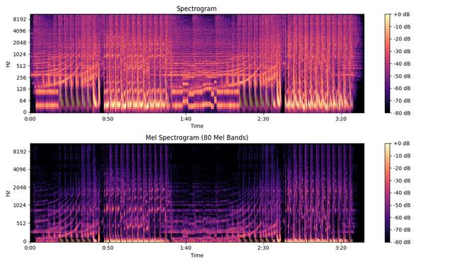
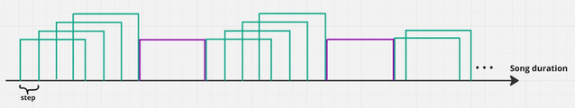

 

  

  <h3 align="center"><b>Songs Recommender System</b></h3>
  

    Content-based music recommendation using deep audio representations
  

---

## 📚 Table of Contents

1. [About](#about)  
2. [Data](#data)  
   - [Dataset Preparation](#dataset-preparation)  
   - [Song Fragmentation](#song-fragmentation)  
3. [Vector Representation Using Neural Networks](#vector-representation-using-neural-networks)  
   - [Neural Network Architecture](#neural-network-architecture)  
   - [Evaluation of Vector Quality](#evaluation-of-vector-quality)  
     - [Grouped Results](#grouped-results)  
     - [Full Breakdown](#full-breakdown)  
   - [Training Infrastructure and Data Storage](#training-infrastructure-and-data-storage)  
4. [How Recommendations Are Made](#how-recommendations-are-made)  
   - [Recommendation Strategy](#recommendation-strategy)  
   - [Explainability](#explainability)  
   - [Recommendation Example](#recommendation-example)  
5. [Future Work and Improvements](#future-work-and-improvements)

---

## About

This project implements a **content-based song recommendation system** built directly on audio data rather than metadata such as artist names or genres.

Using **mel spectrograms** and a **deep neural network**, songs are represented as high-dimensional vectors that capture meaningful musical characteristics. These representations allow the system to discover similarities between songs based purely on how they *sound*, enabling richer and more nuanced recommendations.

The core idea is simple:
> **Similar music should have similar audio representations.**

---

## Data

To build the dataset, a custom scraper was developed to collect all available tracks from **NoCopyrightSounds**  
([website](https://ncs.io/music-search?q=&genre=&mood=&version=regular)) along with their associated tags.

**Dataset overview:**
- 🎵 ~1,700 songs  
- 🏷️ 89 unique tags  

These tags are used as supervision signals during training and for evaluation purposes.

---

### Dataset Preparation

  

<i>Spectrogram vs Mel Spectrogram</i>

Each song is first divided into short audio fragments (see below). For every fragment, a **mel spectrogram** is extracted instead of a standard spectrogram.

Mel spectrograms map frequencies onto the **mel scale**, which better reflects human auditory perception of pitch and loudness. This makes them particularly suitable for music-related tasks such as similarity learning and recommendation.

---

### Song Fragmentation

  

<i>Song fragmentation</i>

<i>Green – training set, Purple – validation set</i>

Each audio track is split into equally sized fragments of `n_seconds`.

Key parameters:
- **Fragment length**: 5 seconds  
- **Step size**: 1 second (overlapping fragments)  
- **Train/validation split**: Random assignment using a configurable `validation_probability`  

Fragments assigned to training and validation sets never overlap, ensuring clean evaluation.

---

## Vector Representation Using Neural Networks

The neural network is composed of multiple processing blocks, with the **final block acting only as a classifier**. This design minimizes the classifier’s influence on the learned representation.

The classifier predicts song tags, forcing the network to learn vectors that capture musically meaningful information.

> **To obtain the final vector representation, the mel spectrogram is passed through the network *without* the classifier.**

---

### Neural Network Architecture

**1. Convolutional Feature Extractor**
- Multiple 1D convolution layers with ReLU activations
- Padding preserves temporal structure
- Max pooling reduces dimensionality

**2. Temporal Modeling**
- 4-layer LSTM
- Hidden size: 256
- Dropout: 0.4

**3. Classifier (used only during training)**
- Fully connected layer (256 → 91)
- Batch normalization
- Sigmoid activation

---

### Evaluation of Vector Quality

Vector quality is evaluated indirectly through **multi-label tag classification**.

The idea is straightforward:
- If vectors contain useful musical information,
- a simple classifier should be able to predict song tags accurately.

**Evaluation metrics:**
- **Binary Cross-Entropy Loss**: `0.0437`
- **Hamming Accuracy**: `0.9835`
- **Exact Match Ratio**: `0.6223`

---

#### Grouped Results

| Incorrect Tags | Samples | Share |
|---------------|---------|-------|
| 0             | 18,933  | 62.23% |
| 1–6           | 9,752   | 32.05% |
| 7–10          | 1,590   | 5.23% |
| 11–14         | 144     | 0.47% |
| ≥15           | 5       | 0.02% |

---

#### Full Breakdown

| Incorrect Tags | Samples | Share |
|---------------|---------|-------|
| 0 | 18,933 | 0.6223 |
| 1 | 2,375 | 0.0781 |
| 2 | 1,777 | 0.0584 |
| 3 | 1,622 | 0.0533 |
| 4 | 1,503 | 0.0494 |
| 5 | 1,350 | 0.0444 |
| 6 | 1,125 | 0.0370 |
| 7 | 726 | 0.0239 |
| 8 | 456 | 0.0150 |
| 9 | 248 | 0.0082 |
| 10 | 160 | 0.0053 |
| 11+ | 146 | <0.005 |

---

### Training Infrastructure and Data Storage

Training was performed on **Google Cloud Platform (Vertex AI)**.  
Models and dataset versions were stored in **Google Cloud Storage**, enabling version control and reproducibility.

⚠️ Due to a **$300 free-trial budget**, training time and resource availability were limited.

---

## How Recommendations Are Made

Recommendations are generated using the learned vector space.

1. The user provides a set of liked songs  
2. Vectors of their song fragments are loaded  
3. A random subset of these vectors is selected  
4. Distances to all other fragments are computed  
5. The closest fragments are used to suggest new songs  

---

### Recommendation Strategy

Each candidate fragment receives a score:

$d = \sum_{i=1}^{n} \| x_i \|_{\ell_2}$

Fragments are discarded if:
- They belong to a song already liked by the user  
- Another fragment from the same song has a lower distance  

The remaining closest fragments form the final recommendations.

---

### Explainability

For every recommendation, the system provides:
- Fragment start time  
- Associated tags  
- Distance score `d`  

Tags from liked songs are also shown for comparison.

---

### Recommendation Example

**Liked song**
- **Title:** 094_-_JOXION  
- **Tags:** Dark, Dreamy, Future House, Glamorous, Gloomy, Sexy, Energetic  

**Recommended fragment**
- **Song:** Pretty_woman_-_The_Saint__Magnus  
- **Distance (d):** 19.76  
- **Start time:** 159s  
- **Tags:** Epic, Euphoric, Happy, House, Restless  

---

### Future Work and Improvements

- 🔧 **Explore richer neural architectures**
- 📐 **Improve recommendation strategies**
- 🎶 **Expand the dataset**
- ⚡ **Introduce a vector database** (FAISS, Milvus, etc.)

